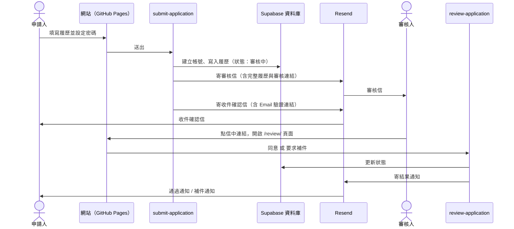
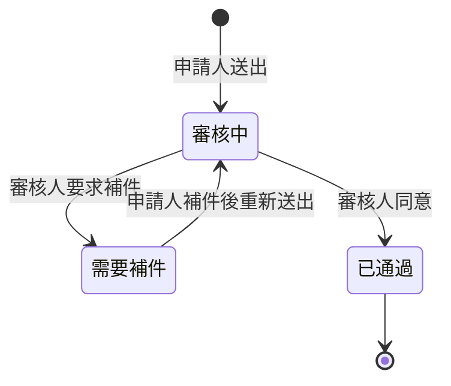

# 機師履歷後端說明

本文件說明「我是機師」履歷表單背後的系統如何運作，以及日常維護方式（更換審核人、新增會員內容、排除寄信問題）。初次部署步驟請見 [supabase/README.md](supabase/README.md)。

## 1. 系統組成

| 元件 | 角色 | 位置 |
| --- | --- | --- |
| **GitHub Pages** | 放置網站前台（純靜態檔案） | repo `got1128/always-happy` 的 `dist/`，推送到 `main` 後自動部署 |
| **Supabase Auth** | 申請人帳號、登入、Email 驗證 | Supabase 專案 `kfhnwmskyayztkqjsvlx` |
| **Supabase Database** | 儲存履歷、審核紀錄、會員內容 | 同上，資料表定義在 `supabase/migrations/` |
| **Supabase Edge Functions** | 伺服器端邏輯：收件、寄信、審核 | `supabase/functions/` |
| **Resend** | 寄出所有通知信 | 寄件網域 `alwhappy.com` |

網站本身不保存任何密碼或金鑰。前台只持有 Supabase 的「公開金鑰」（`dist/assets/config.js`），所有需要權限的動作（建立帳號、寫入資料、寄信）都在 Edge Function 裡用伺服器端金鑰完成。

## 2. 整體流程



### 申請狀態



| 狀態（資料庫值） | 申請人可以做什麼 | 會員內容 |
| --- | --- | --- |
| 審核中（`submitted`） | 登入查看進度，表單鎖定不可修改 | 看不到 |
| 需要補件（`needs_info`） | 登入後看到補件說明，修改資料並重新送出 | 看不到 |
| 已通過（`approved`） | 登入查看狀態 | **看得到** |

補件送出後狀態回到「審核中」，審核人會再收到一封標註「補件」的審核信，必須再次按「同意」才會通過。

## 3. 兩個 Edge Function

### `submit-application`：收件

1. 檢查必填欄位與格式（姓名、Email、電話、持有執照、總飛行時數為必填）。
2. **新申請人**：用申請人設定的密碼建立帳號，並產生 Email 驗證連結。若 Email 已註冊，回覆「請先登入」。
   **已登入且狀態為「需要補件」的申請人**：更新原本的履歷，狀態改回審核中。
3. 寫入 `pilot_applications`，並在 `pilot_application_events` 留下紀錄。
4. 寄給**每一位審核人**一封審核信，再寄收件確認信給申請人。

寄信失敗**不會**讓送件失敗。資料一定會先存好，失敗原因記錄在 `pilot_application_events`（`action = email_failed`）。

### `review-application`：審核

審核人從信中連結開啟 `https://<網站>/review/#t=<簽章>`，頁面會呼叫這個 Function：

- **檢視**：驗證簽章後回傳完整履歷。
- **同意**：狀態改為已通過，寄通過通知給申請人。
- **要求補件**：必須填寫補件說明，狀態改為需要補件，並把說明寄給申請人。

### 審核連結的安全設計

- 每個連結都帶有簽章（HMAC-SHA256，密鑰為 `REVIEW_TOKEN_SECRET`），無法偽造或竄改。
- 連結 **14 天後失效**。
- 連結綁定「該次送件」：申請人補件後，舊連結自動失效，只能用新的審核信處理。
- 每位審核人的連結各自不同，系統會記錄是誰按了同意或補件（`reviewed_by`）。
- 多位審核人同時操作時，只有第一個人會成功，其他人會看到「此案件狀態已變更」。
- 開啟連結後要在頁面上按按鈕並確認才會執行，避免郵件系統自動預覽連結時誤觸。

> ⚠️ 審核信含完整履歷個資，拿到連結的人就能檢視並操作，**請勿轉寄**。

## 4. 資料表

| 資料表 | 內容 | 誰能讀 |
| --- | --- | --- |
| `pilot_applications` | 每位申請人一筆履歷，含案件編號（`AHP-日期-流水號`）、狀態、補件說明 | 申請人只能讀自己那筆；審核人資訊不對申請人公開 |
| `pilot_application_events` | 送件、補件、審核、寄信失敗的完整紀錄 | 僅後台（Supabase Dashboard） |
| `member_content` | 會員專區文章（標題、內文、是否發布） | 僅**已通過審核**的機師 |

權限由資料庫的 Row Level Security 控管。就算有人繞過網頁直接呼叫 API，也讀不到別人的履歷或會員內容。

## 5. 設定值（Edge Function Secrets）

在 Supabase Dashboard → **Edge Functions → Secrets** 管理。修改後**立即生效**，不需要重新部署。

| 名稱 | 用途 | 範例 |
| --- | --- | --- |
| `REVIEWER_EMAILS` | 審核人信箱，多位以逗號分隔 | `審核人A@example.com,審核人B@example.com` |
| `MAIL_FROM` | 寄件人，網域必須是 Resend 已驗證的網域 | `Always Happy <noreply@alwhappy.com>` |
| `SITE_URL` | 網站網址，用來產生信中的連結，結尾不加 `/` | `https://got1128.github.io/always-happy` |
| `RESEND_API_KEY` | Resend 金鑰 | （機密） |
| `REVIEW_TOKEN_SECRET` | 審核連結的簽章密鑰 | （機密） |

Supabase 不會顯示 Secret 的原文，忘記內容時直接重新設定即可。

## 6. 更換審核人

### 方法一：Supabase 網頁後台

1. 登入 [Supabase Dashboard](https://supabase.com/dashboard/project/kfhnwmskyayztkqjsvlx)。
2. 左側選單 **Edge Functions → Secrets**。
3. 編輯 `REVIEWER_EMAILS`，填入新的信箱，儲存。

### 方法二：終端機

在 `site-source/` 資料夾執行（需先 `npx supabase login`）：

```powershell
npx supabase secrets set --project-ref kfhnwmskyayztkqjsvlx "REVIEWER_EMAILS=審核人A@example.com,審核人B@example.com"
```

### 規則與注意事項

- 多位審核人用**半形逗號**分隔，每位會各自收到一封信。
- **請填真實存在的信箱**。寄到不存在的地址會產生退信，影響 `alwhappy.com` 的寄件信譽。
- 修改只影響**之後**的新申請與補件。已寄出的舊審核連結在 14 天內仍然有效；被移除的審核人如果手上還有舊連結，仍然可以操作那些案件。若要讓所有舊連結立即失效，可以同時更換 `REVIEW_TOKEN_SECRET`：
  ```powershell
  $s = node -e "console.log(require('crypto').randomBytes(32).toString('hex'))"; npx supabase secrets set --project-ref kfhnwmskyayztkqjsvlx "REVIEW_TOKEN_SECRET=$s"
  ```
  更換前請先確認沒有「審核中」的案件：系統不會自動補寄審核信，更換後這些案件會沒有任何可用的審核連結。

## 7. 日常操作

| 要做的事 | 在哪裡做 |
| --- | --- |
| 查看所有申請 | Dashboard → **Table Editor → `pilot_applications`** |
| 查看某案件的處理紀錄 | **Table Editor → `pilot_application_events`**，依 `application_id` 篩選 |
| 新增會員文章 | **Table Editor → `member_content`** → Insert row，填 `title`、`body`；`published` 設為 `false` 可先隱藏 |
| 刪除申請人（含其履歷） | **Authentication → Users** → 刪除該使用者，履歷與紀錄會一併刪除 |
| 修改網站畫面 | 修改 `dist/` 內的檔案後推送到 GitHub，約 1 分鐘自動上線 |
| 修改 Edge Function | 修改 `supabase/functions/` 後執行 `npx supabase functions deploy <名稱> --project-ref kfhnwmskyayztkqjsvlx --no-verify-jwt` |

## 8. 疑難排解

沒收到信時，先到 **Table Editor → `pilot_application_events`** 找 `action = email_failed` 的資料，`note` 欄位就是錯誤原因。

| 錯誤訊息 | 原因 | 處理 |
| --- | --- | --- |
| `Resend 401: API key is invalid` | `RESEND_API_KEY` 錯誤 | 到 Resend 建立新金鑰並重設 |
| `Resend 403: This API key is not authorized to send emails from xxx` | `MAIL_FROM` 的網域與金鑰允許的網域不符 | 確認 `MAIL_FROM` 為 `@alwhappy.com`，或重建金鑰時選擇該網域 |
| `Resend 403: domain is not verified` | 寄件網域未在 Resend 驗證 | Resend → Domains 完成 DNS 驗證 |
| `REVIEW_TOKEN_SECRET is missing…` | 簽章密鑰未設定或太短 | 依第 6 節的指令重設 |
| 信中連結打不開 | `SITE_URL` 或 Auth 的 Redirect URLs 不是目前網址 | 兩處都改成目前網址 |
| 送出時顯示「此 Email 已註冊」 | 該 Email 已有帳號 | 申請人先登入再送出；測試帳號可到 Authentication → Users 刪除 |
| 審核頁顯示「此案件狀態已變更」 | 已由其他審核人處理，或申請人已補件 | 以最新的審核信處理 |

信件也可能被分到垃圾郵件或促銷內容，請一併檢查。Resend 後台的 **Emails** 頁面可以看到每封信是否成功送達。

## 9. 網址變更時（例如改用 alwhappy.com）

需要同步修改三處：

1. Secret `SITE_URL` → 新網址。
2. Supabase **Authentication → URL Configuration**：Site URL 與 Redirect URLs（`<新網址>/for-pilots/`）。
3. 若使用 GitHub Pages 自訂網域：repo **Settings → Pages → Custom domain**，並設定 DNS。**不要刪除 Resend 已有的 DNS 紀錄。**

網站內的連結皆為相對路徑，程式不需修改。

## 10. 尚未實作

- 忘記密碼／重設密碼
- 附件上傳（PDF 履歷、執照影本）
- 「不通過」狀態
- 後台案件列表頁（目前使用 Supabase Table Editor）
- 培訓機師、空服員、企業合作、聯絡我們等其他表單仍為預覽，不會儲存資料
